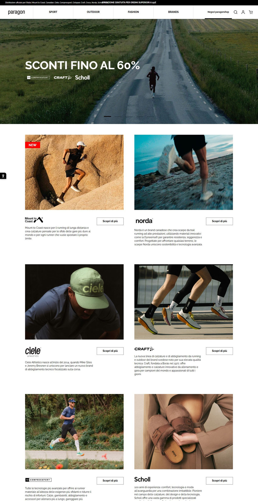

# 精品3：户外编辑零售（Paragon）

指定“精品3／精品站3”或明确选择此参考时采用，先读[编号精品共用说明](numbered-premium-styles.md)。参考：[首页](https://www.paragonshop.it/)、[分类](https://www.paragonshop.it/it/sport/uomo/scarpe/trail-running.html)、[商品页](https://www.paragonshop.it/it/compressport/pro-racing-socks-v40-ultralig.CS.XU00050B?color=BLARE)。2026-11-08已查看桌面／手机首页和PDP、桌面分类及Footer。暂无本编号原生母版。

## 保留的构成

- **导航与首页**：黑色细公告、白色分段主导航，左Logo、购物分支居中、独立工具靠右。宽摄影先建立场景，再以成对编辑图文、系列介绍和精选货架推进购物。1440px观察的Hero约590px高；主内容比全幅Hero收窄，不把每块都铺成同一种全宽Banner。
- **字体与色面**：实际正文为Raleway。黑白承担界面，大图承担色彩，少量红色用于商品状态／有效价格强调；不要从图片颜色或付款组件误推全店主色。
- **分类／卡片**：左侧条件栏、右侧四列浅灰图片面；商品轮廓完整，类别／名称／价格各有层次。品牌、活动、尺码等筛选只用本店真实数据，不为无品牌站制造品牌墙。
- **PDP**：观察样本左侧两张正方形媒体并列，右侧较窄购买列；颜色缩略图、尺码选择、尺码指南与全宽黑按钮。规格、配送、支付、客服用披露区组织，后接相关商品。不要改成所有编号通用的单张大图加长文。
- **Footer**：实际黑底五组视觉内容：店铺导航、购物帮助、客服、较宽的订阅／会员内容、社媒；下方独立白色主体披露条。新店按真实职责删去无业务依据的会员块，联系与政策去重，不能复制来源企业资料。
- **手机**：主导航收为汉堡与工具；编辑双幅变为单列。PDP先完整媒体、再购买信息；Footer纵向收敛。保留密度和清楚的阅读顺序，不把桌面列宽直接缩小。

## 适配与验证

适合品类多、有真实用途／活动层次的运动、鞋服、户外与生活方式目录。保留本参考的成熟关系，换本店图片、文案和真实分类；不是沿用旧Cozyster页面后换色。来源订阅大弹窗已用正常Close关闭再截图，不要求新店复制该打断流程。

本次核实的是布局与默认可见状态，未购买、提交订阅、完整测试筛选／颜色尺码联动或全部轮播。制作时再验证深层菜单返回、图库、当前规格、信息开合、购物反馈与手机。源促销、分期、会员和配送承诺不迁为店铺事实。
