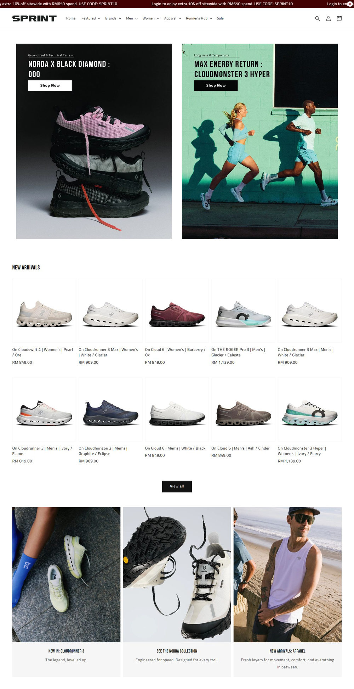

# 精品4：运动专题专门店（Sprint）

指定“精品4／精品站4”或明确选择此参考时采用，先读[编号精品共用说明](numbered-premium-styles.md)。参考：[首页](https://www.sprintmyofficial.com/)、[新品分类](https://www.sprintmyofficial.com/collections/new-arrival)、[PDP](https://www.sprintmyofficial.com/collections/new-arrival/products/on-cloudswift-4-women-s-pearl-ore)。2026-11-08已查看桌面／手机首页与PDP、桌面分类及Footer。暂无本编号原生母版。

## 保留的构成

- **首页**：窄深酒红公告、白导航、左右并列的两幅高竖专题，一幅可主打产品、一幅主打使用场景；不是一张全幅轮播。在1440px观察中，左右图各约635px、间约40px，页面两侧约65px留白。商品陈列、专题与活动／门店内容穿插。
- **字体**：Bebas Neue窄体大写标题与Sunflower正文是实际视觉的重要区分。保持大标题的字宽、节奏和购买文字清晰度；字体须有可使用依据，不借粗黑标题替代整站设计。
- **货架／分类**：观察时首页新品与Road为五列两行，Apparel为四卡；分类左条件栏、右四列。迁移时把首页编辑货架与主商品网格分开实现，不能误称全部都是单排轮播；数据不足时自然收敛。内页默认四／二列原则保留。
- **卡片反馈**：实际悬停核实主辅图透明度互换、标题下划线及圆形快捷入口；新店使用自己的真实辅图。源轻微放大不是必需，有完整图片要求时只换图，不截掉轮廓。触控和单图都有清楚替代路径。
- **PDP**：宽图库靠左、较窄购买信息靠右，大张完整鞋图，窄体标题、真实价格、横排尺码chip、数量与全宽按钮；后有分段功能／用途内容。可见尺码不是原生select，源码select仅作回退。US7选择已核实与radio值同步；未加购。
- **Footer**：白底、左侧品牌介绍及社媒、右侧短服务链接，支付／版权另收尾。保留这种轻尾部关系，本店必要政策以紧凑有效入口补齐，不套深色四大列，不复制门店历史或原站的四个支付开通状态。
- **手机**：390px观察为单张竖幅专题、轻露下一张，下方有1/2与箭头；不是把两张图缩小并排或直接堆成两张长图。PDP图库与购买区纵向排，尺码chip换行；大标题、长商品名和货架密度逐图检查。

## 适配与验证

适合运动鞋、运动服饰和按活动策展的货盘。原站是EasyStore，只迁移视觉与操作关系，购物和表单重新使用Shopify原生能力。优惠条件、性能、成立历史及服务承诺均用本店真实资料；未做真实购买、订阅或结账测试。
