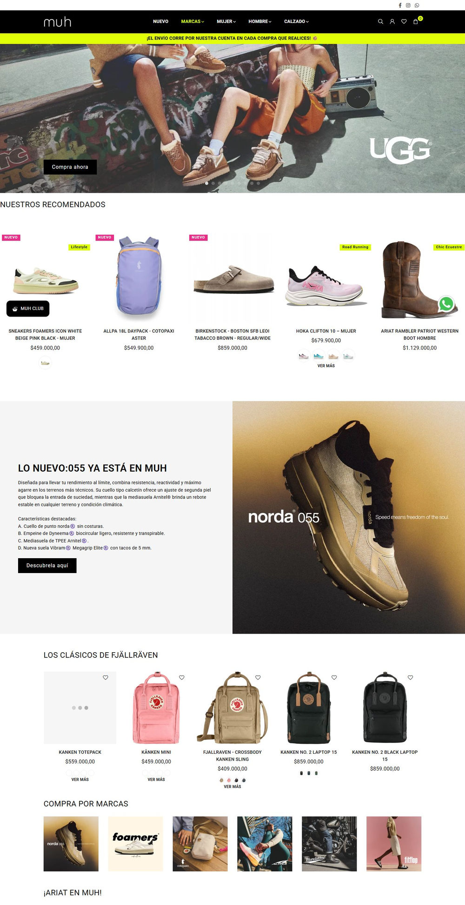

# 精品5：生活方式概念店（Muh）

指定“精品5／精品站5”或明确选择此参考时采用，先读[编号精品共用说明](numbered-premium-styles.md)。参考：[首页](https://muhconcept.com/)、[分类](https://muhconcept.com/collections/nuevo)、[PDP](https://muhconcept.com/products/hoka-clifton-10-mujer)。2026-11-08已查看桌面／手机首页和PDP、桌面分类与Footer。暂无本编号原生母版。

## 保留的构成

- **导航／色面**：实际黑色Header、白色内容面与荧光黄绿公告／动作强调，Roboto正文。黑色只是界面骨架，不把整站或全部照片统一滤暗；商品色彩和摄影承担生活气息。
- **首页节奏**：宽摄影后立即到推荐商品，再由技术新品图文、背包陈列、系列入口、鞋靴／袜子／跑鞋与护理内容接力。专题摄影和可购买货架交替，不能缩成通用Hero＋一组产品＋FAQ。无品牌货盘以真实用途或系列替代来源品牌栏目。
- **商品卡／分类**：桌面首个推荐货架五卡可见、手机两卡；用途／新品标签、主辅图、色卡和适用快捷入口具有层次。分类的左侧过滤与右侧网格承担实际品牌／用途／性别／尺寸／价格条件，新店只使用真实可用条件。
- **PDP**：左侧大图与下方横向缩略图、右侧完整购买区；颜色、尺码、尺码帮助、数量、购买和说明／配送／退换分组。手机图库在上、购买区在下。不存在的门店库存、评论、性能和尺码数据不能为了照参考填入。
- **Footer**：实际黑底四组视觉列为服务、Info、订阅、Logo／社媒；下层版权和支付区。不是只有两组政策的旧Footer。手机服务和Info可折叠，订阅及身份区上下排列。原站三种支付图标不代表本店开通方式。

## 要修正的来源问题

本次源页面在1440／390视口有少量横溢出，部分货架照片还处于加载占位，浮动会员／WhatsApp入口会挤压手机尺码区。保留其专题丰富度和信息关系，修复这些问题；不得把加载占位、遮挡或横向滚动当作精品标准。

轮播观察的是实际拍摄帧，不代表每帧或全部动效通过。图像、色卡与变体、快购、筛选、披露、手机焦点和购买错误需在新店实现后验证；本次没有加购或提交表单。源地区、五天退货、运费、会员、地址和品牌技术文案不迁入本店。
