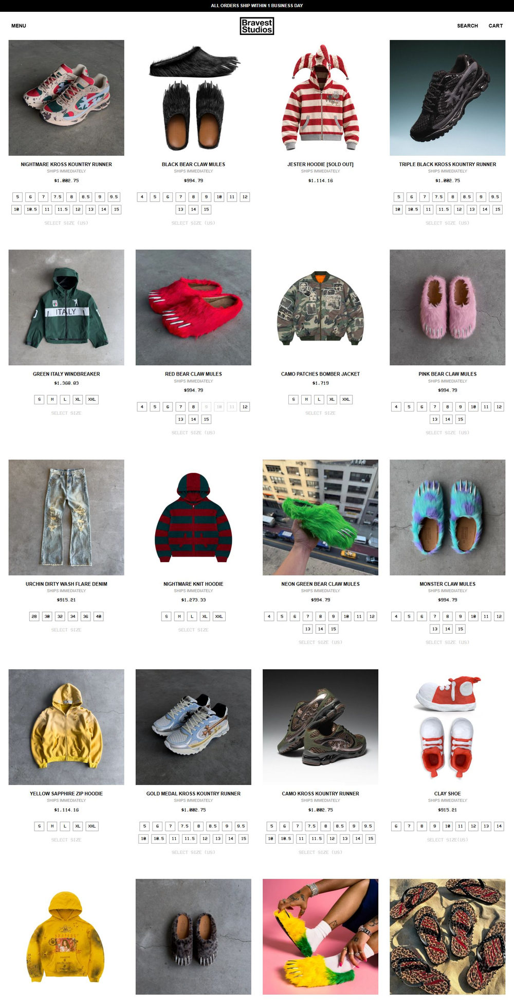

# 精品6：潮流商品档案（Bravest）

指定“精品6／精品站6”或明确选择此参考时采用，先读[编号精品共用说明](numbered-premium-styles.md)。参考：[首页](https://braveststudios.com/)、[卫衣分类](https://braveststudios.com/collections/hoodies)、[PDP](https://braveststudios.com/products/nightmare-kross-kountry-runner)。2026-11-08已查看桌面／手机首页与PDP、桌面分类及PDP Footer。暂无本编号原生母版。

## 保留的构成

- **首页就是目录**：白底、黑色细公告，Menu靠左、店名居中、Search／Cart靠右。没有传统大Hero或先讲故事的长首屏；首屏四列真实商品，手机两列。不要以“精品必须复杂”为由在目录前硬加三卖点、巨型文案和通用品牌故事。
- **卡片**：完整方形照片、紧凑居中的大写名称、较轻辅助行、独立等宽价格和直接尺码格。视觉重点由商品和照片承担；正文Helvetica／Arial，价格具有VCR OSD Mono的等宽角色。没有字体分发依据时选择可使用的替代，不复制来源字体包。
- **购物状态**：不同卡片有真实尺码和售罄差异。当前来源移动端尺码格较长，新店须处理长选项与触控尺寸；不能为了压低卡高隐藏选项，也不能选择单一选项就误买默认组合。辅助文字要比源低对比灰字更清楚。
- **分类**：紧凑标题／排序后延续同一商品档案系统；保留原生过滤和分页能力，不因参考少装饰而删掉有效购物功能。
- **PDP**：观察时左侧大图库约57%、右购买区约43%。桌面纵向媒体与手机轮播分别处理；Details默认展开，Sizing／Delivery折叠。购买区简洁、真实尺码与价格清楚，不套其他编号的长技术故事。
- **Footer**：源首页实际隐藏Footer，PDP显示细分隔线、短政策／FAQ、订阅与版权。新店默认保留这种简洁关系的可编辑页脚，以及本店政策、联系、本地化和实际支付入口；不复制首页隐藏规则，也不强套四列Cozyster。

## 适配与验证

适合商品照片有辨识度的街头服饰、鞋、配件。精致来自图片完整、对齐、规格反馈与持续目录节奏，不能随机加入满屏动效。来源首页约31k高；本次滚动至22k，末段部分照片未加载，不能宣称已核实所有卡片媒体。

源“立即发货”、售罄、发货保障商品、品牌与价格币种仅是观察内容；不作本店承诺或选品。图库、尺码、开合、键盘、触控及原生购买在新店另验，本次未加购／结账。
