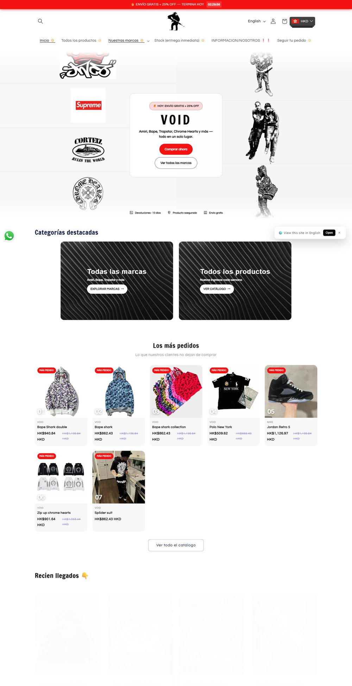

# 精品7：双轨主题橱窗（Void）

指定“精品7／精品站7”或明确选择此参考时采用，先读[编号精品共用说明](numbered-premium-styles.md)。参考：[首页](https://voidbaires.com/en)、[分类](https://voidbaires.com/en/collections/todas-las-marcas)、[PDP](https://voidbaires.com/en/products/campera-bape-x-adidas-negra)。2026-11-08已查看桌面／手机首页与PDP、桌面分类和Footer。暂无本编号原生母版。

## 保留的构成

- **主视觉**：两列反向纵向轨道、边缘渐淡，中央白色行动面板与红色主按钮。轨道和中心构图是此编号的辨识点，不是换成普通左文右图。无品牌店用自己的实际商品／用途摄影承接轨道，不复制来源Logo墙或人物。
- **导航与字型**：居中店名、工具与第二行购物导航；实际正文Questrial、标题Francois One。白／浅灰面承担阅读，红色承担主要行动；界面文字先清楚，不照抄半透明低对比状态。
- **首页目录**：主视觉之后接精选分类、新品／热门和成组商品，图片区与清楚的购物入口连续。轨道可以用轻量CSS实现，但需要暂停／减少动态效果下的静态可读版本，不把所有区块都做成持续运动。
- **分类与卡片**：保留大标题、清楚工具条、完整商品图和同一字型／状态语言；过滤、排序、翻页与价格使用当前Shopify对象，不能靠静态拼图替代真实购物。
- **PDP**：大图库靠左、醒目的窄体标题与购买区靠右，尺码、数量、购买入口及后续披露内容明确。源样本有13项媒体；这是样本事实，不是模板固定图数。手机纵向排列，并检查长标题、规格和服务区。
- **Footer**：源站实际很短，社媒、语言、版权和底行政策，不是四列大页脚。本轮截图未看到付款图标，虽然HTML有区域；新店仍按真实原生数据保留支付和国家／货币能力，不把源码容器当作实际已显示。

## 只取设计，不取缺陷或经营声明

源页面有语言提示浮层、悬浮货币控件，手机尾部部分服务／数字卡文字挤成窄列；新店要修正遮挡和换行。`/en`内仍混有西语，不能把路径当成已完整翻译。语言切换只展示本店后台真实选项。

截图中出现的倒计时、限时25%、客户数字、十天退货、品牌保证和免费配送不属于风格，不移植为本店事实。来源动态画面只是拍摄时的静态帧；没有本次动效／购物流程全量验收。新店需另验轨道减少动态效果、图库、披露、真实规格和购买状态。
